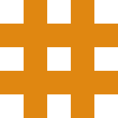

# Lattice

Lattice is a personal research project exploring the design of a modern command-and-control (C2) framework. The work is early, the aim is a system that can eventually stand as a product, and every element of the design remains subject to change.

Despite the early stage, Lattice is intended to be extensible. The name reflects that choice of structure. It does not claim greater extensibility than existing plug-and-play frameworks such as [Mythic](https://github.com/its-a-feature/mythic). It is a design decision, not a comparison.

# Acknowledgements
# License