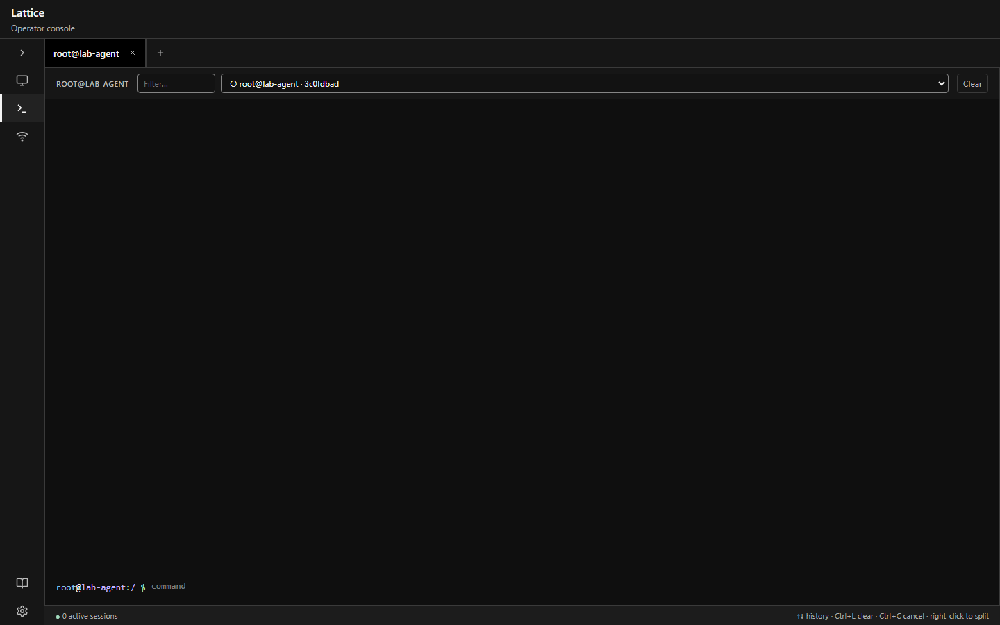

# Lattice

Lattice is a personal research project exploring the design of a modern command-and-control (C2) framework.

It is a Go monorepo with a teamserver, reference agent, operator CLI, Svelte web console, versioned Protobuf contracts, an HTTP(S) channel extension, filesystem catalogs for agent updates and elevate modules, and Docker Compose lab packaging.

## Architecture

### Protocol

- **Agent channel:** Protobuf bodies over HTTPS (`lattice.agent.v1`) at `/v1/checkin`, `/v1/result`, live task output, update download, and elevate module download.
- **Operator API:** Connect (`lattice.operator.v1`) for sessions, tasks, events, listeners, extension reload, and catalog listing.
- **Codegen:** Buf generates Go stubs into `gen/`. Schemas live under `protocol/`.

### Server

The teamserver is the control plane. Operators never talk to agents directly.

- **Operator API** on `:8080` (Connect).
- **Agent ingress** through the loaded HTTP channel (default HTTPS `:8443`).
- **PostgreSQL 16** for agents and tasks (an `operators` table exists in schema and is unused for auth).
- **Listen manager** tracks live channel listeners for `ListListeners`.
- **Extension loader** discovers channel manifests and starts builtin channel factories; `ReloadExtensions` hot-reloads without restarting the process.
- **Catalogs** under `data/updates` and `data/modules` for published agent binaries and BYO elevate modules.
- **Events** are an in-process pub/sub bus for session and task updates (`StreamEvents`).

### Client

- **CLI** (`client/cmd/client`) speaks Connect to the teamserver for sessions, tasks, listeners, and extension reload.
- **Web UI** (`client/ui/web`) is a Vite + Svelte console: Sessions, Console (native shell emulator), Listeners, Docs, and Settings. It speaks only to the operator API.

### Agent

The reference implant shipped with the core. It checks in over the HTTP(S) channel, runs tasked shell and builtins, streams live output, honors cancel, persists cwd, can install/uninstall/cleanup Lattice-managed persistence, pull agent updates, and run published elevate modules.

### Extensions

Channel packages are the installable extension kind in tree today.

- **Channels:** Directory packages under `extensions/channels/*/manifest.yaml`. The in-tree `http` channel is loaded in-process. Install via `install-extension` (`-src`, `-url`, or `-github`), then reload. A new channel *name* still needs a compile-time builtin factory to start.

Elevate modules and agent update artifacts use filesystem catalogs (`data/modules`, `data/updates`), not the channel extension installer.

### Profiles

- **HTTP default profile:** YAML under `profiles/` (for example `http-default.yaml`) consumed by the HTTP channel configuration. This is channel config as data, not a full malleable-profile or payload-generation system.

## Status

Lab-ready vertical slice: Compose teamserver/web, HTTPS agent channel, operator CLI and Svelte console, persistence/update/elevate pipelines, channel extension install/reload, and e2e smoke. Interfaces may still change before a tagged stable release.

Developer docs: [docs/developers/](docs/developers/). Operator runbooks: [docs/operators/](docs/operators/).

## License

MIT License. See [LICENSE](LICENSE) for the full text.
