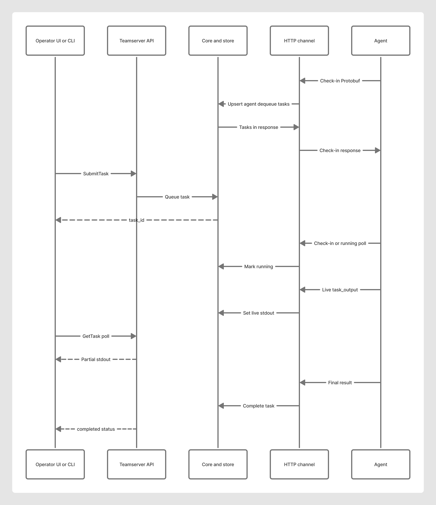

# Agent

Entry: `agent/cmd/agent`.

## Responsibilities

- Persist agent ID (`identity`, `-id-file` / `LATTICE_AGENT_ID_FILE`)
- Check in over HTTPS Protobuf (`transport`)
- Execute tasks: builtins, OS shell (PTY on Unix), persist/cleanup, update, elevate
- Stream live stdout/stderr while running; honor cancel (process group / PTY Ctrl+C)
- Optional always-on install via OS service, logon-task, or startup entry

## Shell model

Console lines are tasked as `shell`. The agent:

1. Intercepts `cd` / `pwd` so cwd persists across one-shot processes
2. Classifies `powershell` / `pwsh` / `cmd` / `bash` / `sh` prefixes
3. Runs under a PTY on Unix with color env (`LS_COLORS`, `FORCE_COLOR`, …)
4. Pushes partial output via `/v1/task_output`
5. On cancel, signals the process tree and finishes with exit `130` when cancelled

PowerShell prefixes are rejected on non-Windows agents.

## Persistence and cleanup

Install order: **service** → **logon-task** → **startup**. See [`../operators/persistence.md`](../operators/persistence.md).

`cleanup` is best-effort removal of Lattice-managed artifacts, not forensic erasure.

## Updates and elevate

- `update` — pull published agent binary from the teamserver catalog
- `elevate <module>` — download BYO module, verify hash, run, delete temp copy

## Lab defaults

- Server: `https://127.0.0.1:8443`
- `-insecure` for lab self-signed certs
- Docker lab agent: `packager/docker/docker-compose.lab.yml` with persisted `agent.id` volume
