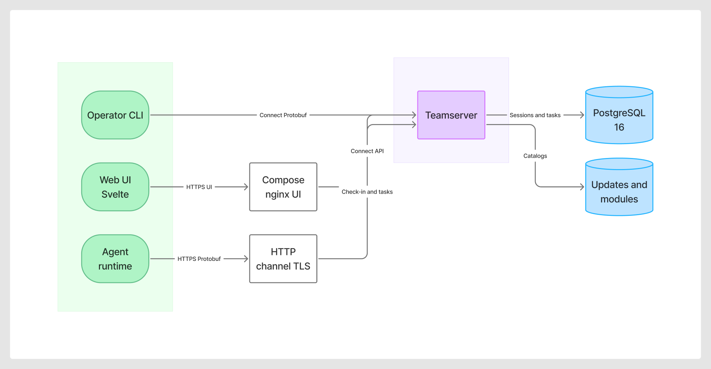

# Architecture

Lattice separates **operator control**, **agent ingress**, and **persistence**. The teamserver is the single control plane process.

## Deployable units

- **Web UI** (`client/ui/web`) — Svelte + Vite SPA. In Compose it is served by nginx on `:3000`, which proxies Connect RPCs to the teamserver.
- **Operator CLI** (`client/cmd/client`) — Connect client for sessions, tasks, listeners, and extension reload.
- **Agent** (`agent/cmd/agent`) — reference implant: check-in, task poll/execute, live output, cancel, update, elevate, persist/cleanup.
- **Compose nginx** — static UI + `/lattice.operator.v1.OperatorService/` proxy.
- **HTTP channel** — agent-facing HTTPS listener (default `:8443`) loaded as an in-process channel extension.
- **Teamserver** (`server/cmd/teamserver`) — Connect operator API (`:8080`), extension loader, listen manager, Postgres store, update/module catalogs.
- **PostgreSQL 16** — agents and tasks (and a reserved operators table).
- **Artifact catalogs** — filesystem stores under `data/updates` and `data/modules` (Compose volume `/data`).

## Control vs agent paths

Operators never talk to agents directly.

1. **Operator path:** UI or CLI → Connect JSON/Protobuf → `OperatorService` on the teamserver.
2. **Agent path:** Agent → HTTPS Protobuf → HTTP channel (`/v1/checkin`, `/v1/result`, task cancel/output, update/module download) → `server/core`.

## Cross-cutting rules

- Command-center host is not a session (`LATTICE_ALLOW_LOCAL_AGENTS=false`; hostname match + startup purge).
- One live session per hostname (check-in dedupes).
- Agent IDs persist on disk so restarts do not multiply rows.
- Extension manifests are discovered from disk; new channel *names* still need a compile-time factory until WASM/out-of-process runtimes exist.
