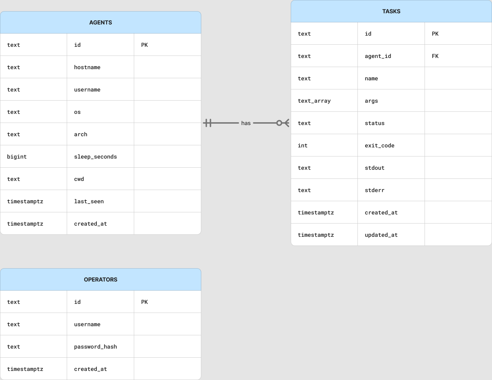

# Data model

PostgreSQL schema is owned by goose migrations under `server/store/migrations/`.

## Tables

### `agents`

Primary implant registry: `id`, host identity fields, `sleep_seconds`, `last_seen`, `created_at`, plus `cwd` (migration `00003`).

### `tasks`

Per-agent work queue/results: `name`, `args[]`, `status`, `exit_code`, `stdout`, `stderr`, timestamps. Cascade-delete with agent.

Statuses used by the product: `queued`, `sent`, `running`, `completed`, `failed`, `cancelled`.

Live streaming updates `stdout`/`stderr` while `status = running`.

### `operators`

Console login accounts (`username`, `password_hash`). Bootstrapped on first start when empty (`LATTICE_BOOTSTRAP_*`; default **admin** / **lattice-change-me**). Bearer sessions live in teamserver memory (not this table). The web UI stores the token in `localStorage` (`lattice.operator.token`) and sends `Authorization: Bearer` on OperatorService calls.

### `loot`

Files uploaded by agents (`download` task) or staged for `upload`: metadata in Postgres, bytes under `LATTICE_LOOT_DIR`.

## Indexes

Migration `00002` adds search/list helpers for large fleets (hostname/last_seen oriented indexes).
