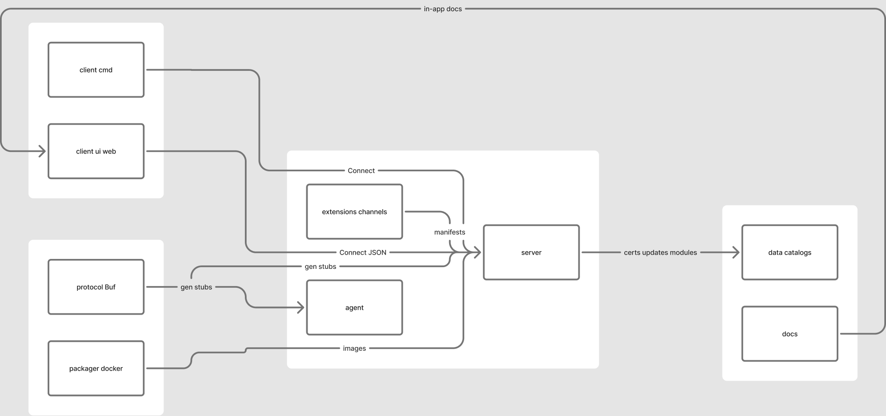

# Monorepo layout

Module path: `github.com/digitizables/lattice` (Go `1.26`).

## Top-level packages

- **`protocol/`** — Buf workspace; `lattice/agent/v1` and `lattice/operator/v1` protos. Generated Go lands in gitignored `gen/`.
- **`server/`** — teamserver binary and libraries:
  - `cmd/teamserver`, `cmd/publish-agent`, `cmd/publish-module`, `cmd/install-extension`
  - `api` Connect handlers, `core` business logic + event bus, `store` pgx + goose
  - `listen` channel manager, `extensions` loader/install/reload, `updates` / `modules` catalogs
  - `config`, `crypto` (lab TLS certs), `httpx` CORS
- **`agent/`** — reference implant:
  - `cmd/agent`, `identity`, `transport`, `runtime` (shell/PTY/builtins/update/elevate), `install` (persist/cleanup)
- **`client/`** — `cmd/client` CLI and `ui/web` Svelte console
- **`extensions/channels/`** — channel packages (`http/` today) with `manifest.yaml`
- **`packager/docker/`** — Compose for postgres/teamserver/web and separate lab-agent compose
- **`profiles/`** — YAML channel profiles (e.g. `http-default.yaml`)
- **`docs/`** — `developers/` and `operators/`
- **`test/e2e/`** — live-stack smoke tests (`-tags e2e`)
- **`data/`** — gitignored runtime (certs, updates, modules)
- **`examples/`** — small samples (e.g. elevate noop)

## What is not in git

- `gen/` — regenerate with `make proto`
- `data/**` contents, `bin/`, `node_modules/`, UI `dist/`
